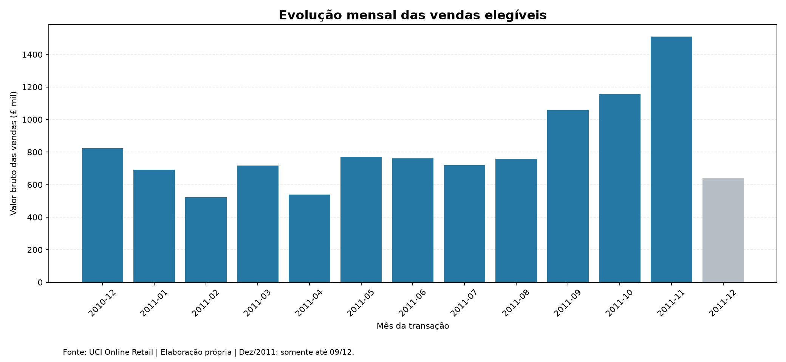
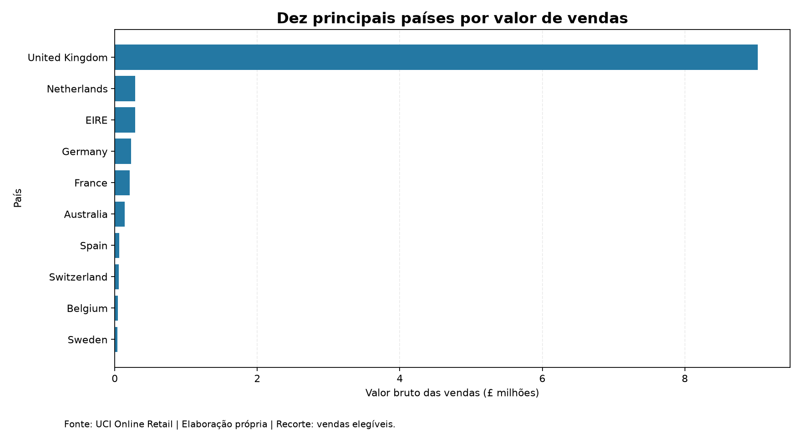
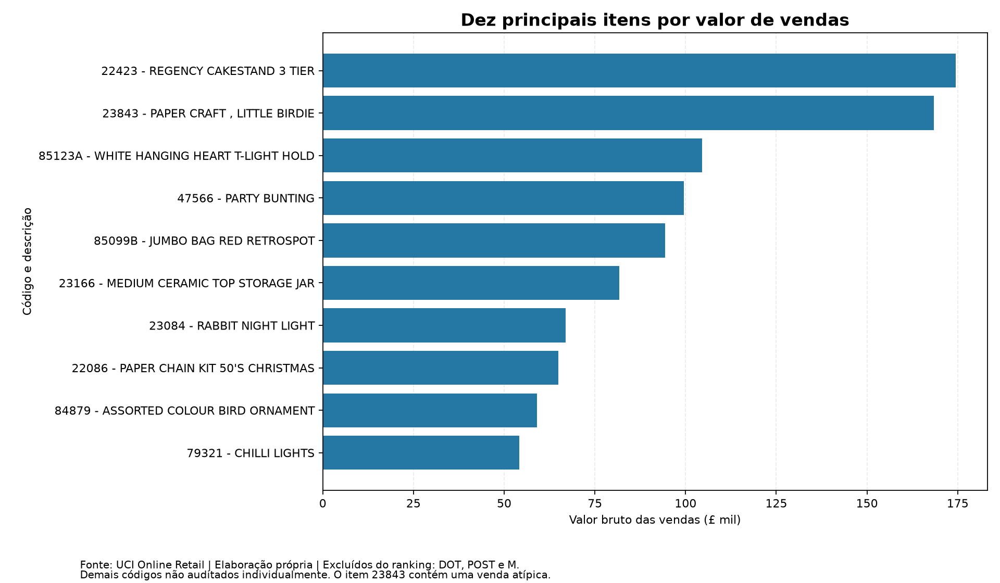

Retail Insights | Análise de Desempenho Comercial no Varejo Online
Projeto Final — Visualização de Dados e Business Intelligence | SENAI/SC — LAB365, Turma T1
Autoria: Elisângela Leal Lima da Encarnação
Status: análise e aplicação local desenvolvidas; publicação e links de entrega pendentes.

### 1. Resumo do projeto

   O Retail Insights é uma solução individual de análise de dados e Business Intelligence desenvolvida em Python e Streamlit, com base no conjunto público Online Retail, disponibilizado pela UCI Machine Learning Repository. O projeto examina o desempenho comercial de um varejista online, combinando diagnóstico de qualidade, ETL, estatística descritiva, análise exploratória, visualizações e dashboard interativo.

Os resultados apresentados representam valores brutos de vendas elegíveis, em libras esterlinas (GBP), e não lucro ou faturamento líquido após cancelamentos.

### 2. Problema, objetivo, relevância e público-alvo

Pergunta orientadora: Como o desempenho comercial do varejo online variou ao longo do período analisado e quais produtos, países e padrões de transação mais contribuíram para as vendas registradas?

Objetivo: caracterizar o desempenho histórico das vendas elegíveis, investigar sua distribuição por período, país e item comercial e tornar os resultados acessíveis por meio de uma interface de BI.

Público-alvo: gestores comerciais, profissionais de análise de dados e equipes de BI que precisam acompanhar indicadores, identificar concentrações e comunicar achados de maneira compreensível.

Relevância: uma análise estruturada de vendas permite acompanhar padrões de demanda registrada e apoiar perguntas gerenciais sobre concentração geográfica, volume, frequência e distribuição monetária das transações.

### 3. Escopo e resultados esperados

Incluído: diagnóstico da qualidade da base; classificação das transações; recorte de vendas elegíveis; indicadores comerciais; estatísticas descritivas por pedido; análises mensal, geográfica e por item; gráficos; aplicação Streamlit com filtros de período e país.

Fora do escopo: previsão de vendas, aprendizado de máquina, cálculo de lucro/margem, determinação de causas de variações, identificação individual de clientes, mensuração de faturamento líquido após cancelamentos e recomendações comerciais automatizadas.

Critérios de conclusão analítica: total das vendas e unidades conciliado entre base e agrupamentos; indicadores consistentes; visualizações com unidades e fonte; regras e limitações explicitadas; funcionamento local do dashboard verificado.

### 4. Fonte, obtenção, período, licença e campos

- Conjunto: Online Retail — UCI Machine Learning Repository.
- Responsável e autoria da base: Daqing Chen, disponibilizada na UCI em 2015.
- Endereço: https://archive.ics.uci.edu/dataset/352/online+retail
- DOI: https://doi.org/10.24432/C5BW33
- Método: download do arquivo público Online Retail.xlsx, sem API, scraping ou coleta de dados privados.
- Período dos registros: 01/12/2010 a 09/12/2011. O mês de dezembro de 2011 é parcial.
- Base original: 541.909 linhas, com oito campos observados no arquivo Excel.
- Campos: InvoiceNo, StockCode, Description, Quantity, InvoiceDate, UnitPrice, CustomerID e Country.
- Moeda original: libra esterlina (GBP).
- Licença informada pela UCI: Creative Commons Attribution 4.0 International (CC BY 4.0); exige atribuição apropriada à fonte. Consulte os termos originais no link do conjunto.
- Data de acesso/download: [PREENCHER COM A DATA REAL DE ACESSO AO ARQUIVO — NÃO INVENTAR].
  Referência da base: Chen, D. (2015). Online Retail [Dataset]. UCI Machine Learning Repository. https://doi.org/10.24432/C5BW33.

Privacidade: o campo CustomerID não foi incluído na base analítica exportada nem é utilizado para identificar pessoas no dashboard. A publicação deverá ser revisada para não expor dados pessoais ou credenciais.

### 5. Metodologia e pipeline de ETL

O projeto foi organizado em módulos independentes, documentados e executados sequencialmente, mantendo uma cópia do arquivo original.


**Fluxo geral do projeto:**

```text
Arquivo público UCI (Excel)
          |
          v
01 - Verificação da base
          |
          v
02 - Diagnóstico de qualidade
          |
          v
03 - Investigação de inconsistências
          |
          v
04 - Classificação das transações
          |
          v
05 - Preparação da base analítica (CSV)
          |
          v
06 - Indicadores e estatísticas
          |
          v
07 - Análise temporal
          |
          v
08 - Análise geográfica
          |
          v
09 - Análise de produtos
          |
          v
10 - Geração dos gráficos
          |
          v
app.py - Dashboard Streamlit
```

### 5.1. Regras de qualidade e classificação

Na base original foram identificados, entre outros pontos:
Ocorrência	Resultado observado	Decisão
Descrições ausentes	1.454	Sinalização e investigação
Identificadores CustomerID ausentes	135.080	Não exportar CustomerID na base analítica
Duplicações exatas além da primeira ocorrência	5.268	Sinalizadas, não removidas por ausência de identificador único de linha
Linhas presentes em grupos duplicados	10.147	Monitoradas separadamente
Linhas com nota iniciada por C	9.288	Classificadas como cancelamento
Quantidade negativa sem nota iniciada por C	1.336	Classificadas separadamente
Preço negativo	2	Classificado como ajuste de preço negativo
Preço zero	2.515	Identificado com indicador próprio; algumas linhas se sobrepõem a outras categorias

A classificação final é exclusiva (cada registro pertence a um único status):
Status_Transacao	Registros
VENDA_VALIDA	530.104
CANCELAMENTO	9.288
QUANTIDADE_NEGATIVA_SEM_C	1.336
PRECO_ZERO	1.179
AJUSTE_PRECO_NEGATIVO	2
Total	541.909

As categorias seguem prioridade de classificação. Por isso, o número total de preços zerados (2.515) é maior do que os registros classificados exclusivamente em PRECO_ZERO (1.179).

### 5.2. Preparação da base analítica

São elegíveis para o estudo de vendas os registros com número de nota sem prefixo C, quantidade positiva e preço unitário positivo. Para cada linha elegível, foi calculado:
Valor_Linha_GBP = Quantity * UnitPrice
O recorte final possui 530.104 linhas e foi exportado para dados/tratados/vendas_elegiveis.csv. As decisões foram registradas nos módulos Python; resumo_status.csv permite auditar a classificação. Não houve exclusão automática de duplicidades.

### 6. Ferramentas e bibliotecas

Ferramenta	Aplicação
Python 3.12	Linguagem de desenvolvimento
VS Code	Ambiente local
Pandas	Leitura, ETL, agrupamentos, estatística e validações
NumPy	Apoio a operações numéricas
Matplotlib	Gráficos da análise exploratória
Streamlit	Interface de BI e filtros interativos
OpenPyXL	Leitura do arquivo original XLSX via Pandas
Git e GitHub	Controle de versão e repositório pessoal
Trello	Organização e acompanhamento do projeto

As dependências necessárias à instalação estão em requirements.txt. Referências oficiais: https://docs.python.org/3/ ; https://pandas.pydata.org/docs/ ; https://matplotlib.org/stable/ ; https://docs.streamlit.io/ .

### 7. EDA, estatística descritiva e resultados encontrados

O relatório usa valor bruto elegível, por pedido, país, mês e código de item.

### 7.1. Indicadores comerciais

Indicador	Resultado
Valor bruto total de vendas elegíveis	£10.666.684,54
Pedidos distintos	19.960
Unidades registradas nas vendas elegíveis	5.588.376
Ticket médio por pedido	£534,40
Mediana por pedido	£303,84
Desvio-padrão dos valores por pedido	£1.780,49
Maior valor observado em um pedido	£168.469,60

O valor médio superior à mediana indica uma distribuição assimétrica à direita, influenciada por pedidos de alto valor. A mediana representa melhor o valor central do pedido típico nesse conjunto.

### 7.2. Evolução temporal

- Novembro de 2011 registrou o maior valor mensal: £1.509.496,33, aproximadamente 14,15% do valor de todo o recorte.
- Fevereiro de 2011 registrou o menor valor entre os meses completos: £523.631,89.
- Setembro, outubro e novembro de 2011 apresentaram aumento sucessivo dos valores registrados.
- Dezembro de 2011 termina em 09/12, não sendo comparável diretamente a meses completos.


Fonte: UCI Online Retail; elaboração própria. Valores expressos em GBP.

### 7.3. Distribuição geográfica

- O Reino Unido concentra £9.025.222,08, ou 84,61% do valor bruto elegível.
- Os demais países, em conjunto, concentram £1.641.462,46, ou 15,39%.
- Entre os mercados internacionais com maior valor registrado estão Países Baixos, Irlanda, Alemanha e França.
  A concentração geográfica representa uma característica observada nos dados, sem provar dependência econômica atual nem potencial futuro de expansão.


Fonte: UCI Online Retail; elaboração própria. Valores expressos em GBP.

7.4. Produtos e itens comerciais

- O código 22423, REGENCY CAKESTAND 3 TIER, registra £174.484,74 em vendas elegíveis.
- O código 23843, PAPER CRAFT, LITTLE BIRDIE, registra £168.469,60 em um único pedido, caracterizando observação de grande influência na análise.
- Os códigos DOT, POST e M representam lançamentos de postagem ou registros manuais e foram retirados apenas do ranking visual selecionado, sem exclusão dos dados de análise.
- 212 códigos apresentam mais de uma descrição padronizada. O agrupamento por StockCode reduz a fragmentação decorrente das variações de descrição.


Fonte: UCI Online Retail; elaboração própria. Ranking visual sem DOT, POST e M; demais códigos não auditados individualmente.

8. Discussão e conclusão
   A análise evidencia concentração comercial geográfica, com 84,61% do valor bruto elegível no Reino Unido; uma elevação dos valores mensais de setembro a novembro de 2011; e heterogeneidade nos valores por pedido, visto que a média (£534,40) excede a mediana (£303,84).

Nos rankings, a liderança por valor não implica necessariamente maior volume de unidades ou maior frequência de pedidos. Além disso, códigos ligados a postagem e registros atípicos exigem interpretação cautelosa.

Conclusão: o pipeline e o dashboard permitem descrever o histórico comercial do varejista e formular perguntas de gestão sustentadas por dados. Os resultados não autorizam inferir lucros, causalidade, sazonalidade demonstrada estatisticamente ou previsão de vendas futuras.
9. Potencial uso profissional
Uma versão corporativa da solução poderia apoiar monitoramento comercial, comparação entre mercados, acompanhamento de mudanças no valor médio por pedido e comunicação entre áreas comerciais e de BI. Para operacionalização seriam necessários atualização periódica e controlada, validações de origem, testes automatizados, documentação de regras comerciais, gerenciamento de acessos, tratamento de dados pessoais, controle de versões e observabilidade do processo.
10. Aplicação Streamlit
URL pública da aplicação: [PREENCHER APÓS DEPLOY OFICIAL].

O dashboard apresenta cinco seções:

1. Visão geral: valor bruto elegível, pedidos, unidades, ticket médio e mediana.
2. Evolução temporal: comportamento mensal das vendas.
3. Países: concentração geográfica e comparação dos mercados.
4. Produtos: ranking por valor monetário ou quantidade, com opção de retirar DOT, POST e M do ranking visual.
5. Metodologia: fonte, critérios de ETL, escopo e limitações.
   Interações: filtros de data e país; opção de exibição monetária original em GBP ou simulação em BRL com taxa manual. A conversão ilustrativa não representa taxa cambial oficial nem altera os valores originais. Os indicadores devem refletir os filtros ativos.
6. Como instalar e executar localmente
   11.1. Pré-requisitos

- Python 3.12 (ambiente usado no desenvolvimento).
- Git, caso deseje clonar o repositório.
- Arquivo público Online Retail.xlsx, obtido na UCI (caso precise reproduzir a ETL).
- Acesso à internet apenas para obtenção do arquivo e instalação de dependências.
  11.2. Clonar, instalar e executar (PowerShell / Windows)

# 1. Clone o repositório quando o endereço privado for disponibilizado

# git clone <URL_DO_REPOSITORIO_AUTORIZADO>

# 2. Acesse a pasta do projeto

cd C:\Portfolio\Retail_Insights

# 3. Se necessário, crie e ative um ambiente virtual

python -m venv .venv
.\.venv\Scripts\Activate.ps1

# 4. Instale as bibliotecas

python -m pip install -r requirements.txt

# 5. Execute o dashboard (com a base tratada disponível)

python -m streamlit run app.py
A aplicação geralmente estará disponível em http://localhost:8501; a porta poderá ser diferente caso esteja ocupada.

Caso a base tratada não esteja presente: faça o download do arquivo Online Retail.xlsx na UCI, coloque-o em dados/originais/ e execute sequencialmente os scripts src/01_...py a src/05_...py seguindo as instruções do projeto. Para regenerar análises e gráficos, execute os módulos 06 a 10, nessa ordem. Não execute tudo automaticamente sem confirmar dependências e resultados intermediários.

Observação sobre publicação: um deploy deve ter acesso ao arquivo de dados necessário, de forma compatível com os requisitos de privacidade, licença e acesso ao repositório; isso será validado antes da disponibilização pública.
12. Estrutura do projeto
Retail_Insights/
├── app.py                         # Interface Streamlit
├── README.md                      # Documentação e instruções
├── requirements.txt               # Dependências Python
├── .gitignore                     # Exclusões do versionamento
├── dados/
│   ├── originais/
│   │   └── Online Retail.xlsx     # Base pública obtida na UCI
│   └── tratados/
│       ├── vendas_elegiveis.csv   # Recorte analítico, sem CustomerID
│       └── resumo_status.csv      # Distribuição das classificações
├── src/
│   ├── 01_verificar_base.py
│   ├── 02_diagnostico_qualidade.py
│   ├── 03_investigar_inconsistencias.py
│   ├── 04_classificar_transacoes.py
│   ├── 05_preparar_base_analitica.py
│   ├── 06_indicadores_comerciais.py
│   ├── 07_analise_temporal.py
│   ├── 08_analise_paises.py
│   ├── 09_analise_produtos.py
│   └── 10_visualizar_resultados.py
├── resultados/
│   ├── *.csv                      # Indicadores e agrupamentos
│   └── graficos/
│       ├── 01_vendas_mensais.png
│       ├── 02_vendas_por_pais.png
│       └── 03_top_produtos.png
├── docs/                          # Documentação complementar
└── notebooks/                     # Espaço reservado para exploração
A pasta .venv é local e não deve ser versionada. Arquivos transitórios gerados por extensões do editor também não devem integrar a entrega.
13. Limitações e melhorias futuras

- Dados de 2010–2011, sem garantia de representar o comércio atual.
- Dezembro de 2011 incompleto.
- Duplicidades mantidas por ausência de identificador único de cada linha transacional.
- Categorias de cancelamento e ajuste não entram no total de vendas elegíveis.
- Ausências e variações na descrição dos itens; códigos de serviços ou postagem entre os lançamentos.
- Pedido muito elevado que influencia medidas agregadas.
- Média e mediana calculadas por nota distinta, sem análise de lucro, impostos, frete líquido ou margens.
- A conversão para BRL, quando habilitada, depende de taxa manual ilustrativa.
  Melhorias futuras fora do escopo avaliativo: atualização automática de dados, cadastro confiável de categorias de produto, controles automatizados de qualidade, fonte corporativa governada, testes e indicadores financeiros líquidos.

14. Créditos, atribuição e referências

- Base de dados: Chen, D. (2015). Online Retail [Dataset]. UCI Machine Learning Repository. https://doi.org/10.24432/C5BW33. Licença CC BY 4.0.
- Python: https://www.python.org/ ; documentação: https://docs.python.org/3/ .
- Pandas: https://pandas.pydata.org/docs/ .
- Matplotlib: https://matplotlib.org/stable/ .
- Streamlit: https://docs.streamlit.io/ .
- OpenPyXL: https://openpyxl.readthedocs.io/ .
- Contexto acadêmico: Projeto Avaliativo — Visualização de Dados e Business Intelligence, SENAI/SC — LAB365, Turma T1.
  Autoria do trabalho avaliativo: desenvolvimento individual. Qualquer apoio, referência ou ferramenta adicional empregada deverá ser creditado conforme as regras da disciplina.

15. Organização, publicação e links de entrega
    Preencher somente após cada publicação efetiva, verificando se os endereços abrem com as permissões exigidas:
    Entrega	Endereço / evidência
    Repositório pessoal GitHub (privado)	[INSERIR URL E PERMISSÃO DE AVALIAÇÃO]
    Histórico de commits	[VALIDAR NO GITHUB]
    Quadro Trello	[INSERIR LINK COM ACESSO AUTORIZADO]
    Aplicação Streamlit publicada	[INSERIR LINK PÚBLICO]
    Projeto no repositório oficial da turma	[INSERIR LINK]
    Publicação do vídeo no LinkedIn	[INSERIR LINK]
    Vídeo no Google Drive (leitor para quem tem o link)	[INSERIR LINK]
    AVA — registro de submissão	[REGISTRAR APÓS ENVIO]

O vídeo deve ter até três minutos e a publicação profissional deve marcar professor, LAB365, SENAI Santa Catarina e FIESC, conforme o documento da disciplina. Após a submissão, o repositório não deve ser alterado até a avaliação, salvo orientação do professor.
16. Interpretação das evidências e integridade
Os achados reportados são observações descritivas, não testes de causa e efeito. Hipóteses — por exemplo, possíveis razões para a elevação de setembro a novembro — demandariam informações e análises adicionais. Recomendações práticas dependeriam também de custos, margens, objetivos comerciais e validação operacional.

Os totais monetários foram reconciliados entre a base tratada e os agrupamentos temporal, geográfico e por item. Os arquivos originais foram preservados durante o desenvolvimento, e a base destinada à análise não exporta identificadores de clientes.
Checklist antes de entregar: conferir README.md, .gitignore, requirements.txt, acesso aos dados no deploy, links, permissões, data real de acesso ao dataset, correções visuais da interface e vídeo; fazer a submissão no AVA e não alterar os arquivos após a entrega.
